# NetPrism

> **把一整个模型文件夹，变成一座可以走进去看的 3D 棱镜。**
>
> 一键扫描 PyTorch 源码 → 解析每一层的张量形状、卷积核、注意力头与 FFN →
> 浏览器里拖拽、缩放、悬停，看清网络到底长什么样。

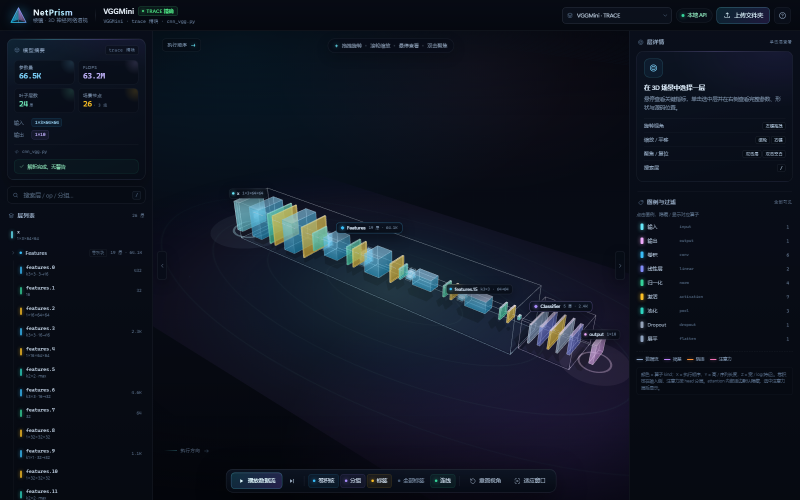

NetPrism 面向这样的日常场景：别人（或 AI）扔给你一个文件夹，里面是若干 `model.py`，
你想在几分钟内搞清楚——

- 它到底是 CNN、Transformer 还是混合结构？
- 每一层的输入输出张量长什么样？通道数在哪一层翻倍？
- 卷积核多大、stride 多少？Transformer 有几个头、FFN 扩张几倍？
- 残差和 U-Net skip 连到哪里？参数量和 FLOPs 花在哪些层？

## 特性

- **一键解析整个文件夹**：递归发现 `nn.Module`，自动识别顶层模型，跳过工具代码。
- **真实仓库友好**：识别 `ResNet18()` 这类工厂、包内相对导入（`from .unet_parts import *`）、
  跨文件组件与 dataclass 配置；同类工厂变体默认折叠，列表保持可读。
- **多格式**：PyTorch 源码、ONNX、TorchScript、Keras v3 `.keras` 均可解析（同一文件夹混放也可以）。
- **双引擎**：`trace` 模式真实执行前向图，形状/连边精确；`static` 模式只读 AST，不执行代码。静态引擎支持多输入、模块级 helper、FFT/einsum、topk/gather 等通用 shape 规则；真正未知的调用保守标为 `custom` + 未知维度，**不会把未知函数当 identity** 继续传播。
- **算法理解**：102 个架构家族 / 56 个组件知识库；识别 ResNet、DenseNet、MobileNet、ConvNeXt、ViT、Swin、Transformer、GPT、LLaMA、Mamba、RWKV、GNN、PointNet、UNet、NeRF、VAE、Diffusion 等；输出模式公式、家族置信度与证据、forward 伪代码。
- **科研分析**：参数量、FLOPs/MACs、激活显存、感受野；Markdown/CSV/HTML 报告；两个模型的层/形状/参数对比。
- **3D 张量视图**：CNN 特征图按 `H × W × C` 体积呈现，卷积核以网格悬浮在输入侧；
  Transformer 以 token × embedding 板 + 多头薄片呈现；Linear/FFN 用扩张-收缩板表示。
- **组件级识别**：Conv-BN-ReLU、Residual Block、Multi-Head Attention、FFN、Transformer Encoder、
  U-Net 编解码、RNN/LSTM、自定义 `SelfAttention` 等。
- **可交互**：拖拽旋转、滚轮缩放、悬停 tooltip、点击聚焦、层列表/搜索/图例过滤、数据流播放。
- **上传即看**：把文件夹拖进浏览器，静态解析后直接渲染（默认不执行上传的代码）。
- **零前端构建**：原生 ES modules + 本地 vendored Three.js，`python -m netprism serve` 即用。

## 快速开始

要求 Python ≥ 3.10。解析 `trace` 模式需要 PyTorch；只做静态解析则不需要。

```powershell
# 最省事：双击仓库根目录的 start_web.cmd（本机起服务 + 自动打开浏览器）

# 在本仓库根目录（Windows 可直接用 netprism.cmd，会自动找解释器）
.\netprism.cmd view .\samples --open

# 通用写法
python -m netprism view .\samples --open
```

打开后会看到 `samples/` 里所有模型的 3D 结构。也可以分步：

```powershell
# 1) 只解析，产出 JSON
python -m netprism scan .\samples --out .\netprism_out

# 2) 起服务查看结果
python -m netprism serve .\netprism_out --port 8765 --open

# 3) 终端里快速看某个文件
python -m netprism inspect .\samples\resnet_mini.py
```

解析模式：

```powershell
# 默认 trace：导入并真实 forward，形状与残差连边最准确
python -m netprism scan .\models --out .\out

# 安全模式：完全不执行代码，只做 AST 静态推导
python -m netprism scan .\models --out .\out --static

# 真实仓库通常有 ResNet18/34/50... 多个工厂变体：默认每个类只保留第一个；
# --all-variants 全部保留，--class 精确选择其中一个
python -m netprism scan .\models --all-variants --out .\out
python -m netprism scan .\models --class ResNet50 --out .\out

# 多格式（.onnx / .pt / .keras）自动发现；只扫 .py 时加 --no-formats
python -m netprism scan .\models --out .\out

# 论文/评审材料
python -m netprism report .\out --model resnet50 --format md --out report.md
python -m netprism report .\model.onnx --format html --out report.html
python -m netprism compare .\out .\out --model-a resnet18 --model-b resnet34

# 算法理解：家族 / 模式公式 / forward 伪代码
python -m netprism explain .\out --model resnet50
python -m netprism explain .\model.onnx --json
```

报告/对比也接受 `graph.json`、scan 输出目录、模型文件（`.py/.onnx/.pt/.keras`）。

> ⚠️ `trace` 模式会导入并执行目标文件夹里的 Python 代码。只对可信代码使用；
> 来历不明的模型请用 `--static`。Web 端“上传文件夹”默认就是静态解析，且服务端默认拒绝执行上传代码。

## Web 服务 + 浏览器（当前主用模式）

**本机起服务，浏览器里看。** 这是现在交付和日常使用的方式：不需要打包、不需要前端构建。

```powershell
# 最省事：双击仓库根目录的 start_web.cmd
# 它会在 127.0.0.1:8765 起服务（端口被占用会自动换一个）并打开浏览器
```

等价的手动命令：

```powershell
# 直接看内置 demo
python -m netprism serve examples\demo --port 8765 --open

# 先扫描自己的模型目录，再起服务
python -m netprism scan .\models --out .\netprism_out
python -m netprism serve .\netprism_out --port 8765 --open
```

- 页面：<http://127.0.0.1:8765/>；关掉命令行窗口（或 Ctrl+C）即停止服务。
- 数据默认用内置 `examples/demo`（8 个模型）。
- 浏览器里可以直接把模型文件夹拖进去，走静态解析（默认不执行上传的代码）。
- 桌面的 `NetPrism Web.cmd` 是同一个启动器的快捷方式。

## 原生 GUI（已暂停）

> **2026-11-25 用户决定**：原生 PySide6 窗口的 3D 拖拽 / 窗口 / 启动体验“基本用不了”，
> 停用桌面 GUI，回到 Web 服务 + 浏览器模式。GUI 源码（`netprism/gui/`）与构建脚本
> （`scripts/build_gui.ps1`）仍保留在仓库里，但不再作为交付形态；桌面上的
> `NetPrism.exe` 已改名为 `NetPrism-gui-old.exe`。

<details>
<summary>历史记录：原生 GUI 的形态、用法与构建方式</summary>

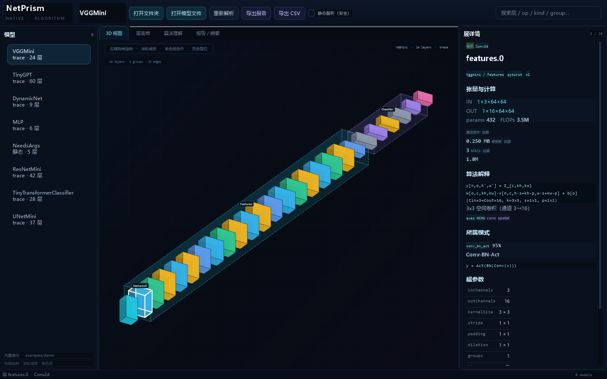

VoronoiCNN 的通道厚度示例（4→32→64→3）：

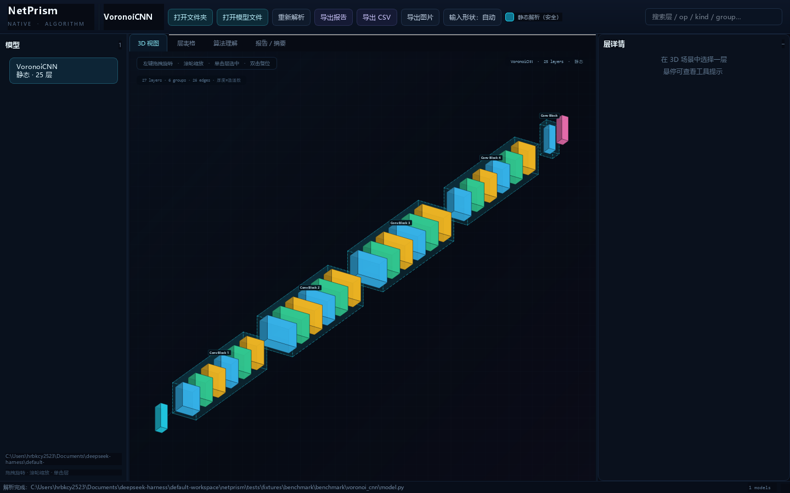

VoronoiCNN 静态解析的未知输入尺寸（`1×4×?×?×?`）：

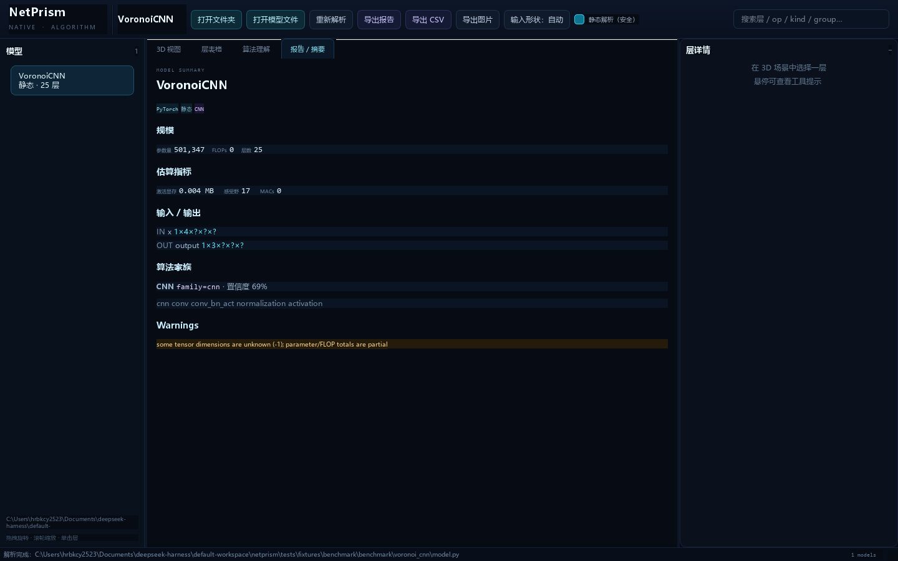

| 形态 | 路径 | 大小 | 说明 |
|---|---|---|---|
| **单文件 GUI** | [`dist/gui/NetPrismGUI.exe`](dist/gui/NetPrismGUI.exe) | 231 MB | 复制这一个 exe 即可分发；首次启动解压约 7 秒 |
| **目录版 GUI** | [`dist/gui/NetPrismGUI/NetPrismGUI.exe`](dist/gui/NetPrismGUI/NetPrismGUI.exe) | 624 MB（整个目录） | 启动更快；必须保留同目录 `_internal/` |

用法：

- **双击** → 载入内置 8 个模型 demo，显示原生 3D 视图。
- **打开文件夹 / 打开模型文件** → 在 GUI 内解析；支持 `.py/.onnx/.pt/.pth/.keras`。
- **静态解析（安全）** 复选框：勾选后只读 AST，不执行模型代码；默认 trace。
- **输入形状**：静态模式下未指定的空间/序列维显示为 `?`（不再伪造 16×16×16）；点“输入形状”可填 `1,4,?,?,?` 或具体 `1,4,16,16,16`，自动重算 FLOPs/形状。
- **层表格**：排序、搜索、导出 CSV；**算法理解**：家族/模式公式/伪代码；**报告/摘要**：导出 Markdown/HTML。
- **导出图片**：自动选择适合 16:9 的视角，导出 1920×1080 PNG（`Ctrl+Shift+E`）。
- 3D 盒子的**厚度 = 通道数**（按全图最大通道线性归一化）；4→32→64→3 会显示为明显的薄→厚→薄，而不是统一厚度。
- 拖模型文件夹/文件到 exe 上也可以直接打开。
- CLI 仍保留：`.\netprism.cmd scan ...`、`report`、`compare`、`explain`；旧的 `dist\NetPrism-Portable.exe` 是 CLI/浏览器版，不是 GUI。

> 单文件 GUI 会把运行时解压到**当前目录**的 `netprism_gui_runtime\`，请放在可写目录（桌面、文档、D 盘工具目录），
> 不要直接放在 `C:\Program Files`。目录版没有这个限制。
>
> exe 未做代码签名，Windows SmartScreen 可能提示“未知发布者”；确认来源后选择“更多信息 → 仍要运行”。
>
> GUI 源码无 `http.server` / `webbrowser` / `QWebEngine` 依赖；内置数据含 demo、算法知识库和 schema。

```powershell
$py = "C:\Users\hrbkcy2523\.dsh\dsh-runtimes\dsh-primary-runtime\dependencies\python\python.exe"

# 目录版 GUI（启动快）
.\scripts\build_gui.ps1 -Python $py

# 单文件 GUI
.\scripts\build_gui.ps1 -Python $py -OneFile
```

</details>


## Code signing policy

**Free code signing provided by [SignPath.io](https://about.signpath.io), certificate by [SignPath Foundation](https://signpath.org).**

签名只由 GitHub Actions 从本仓库源码构建的 `NetPrismGUI.exe` 产生；本地不持有私钥。团队角色、隐私与卸载说明见 [`CODE_SIGNING_POLICY.md`](CODE_SIGNING_POLICY.md)，申请/配置步骤见 [`docs/SIGNING.md`](docs/SIGNING.md)。

重新构建：

```powershell
$py = "C:\Users\hrbkcy2523\.dsh\dsh-runtimes\dsh-primary-runtime\dependencies\python\python.exe"

# 目录版 GUI（启动快）
.\scripts\build_gui.ps1 -Python $py

# 单文件 GUI（最终分发）
.\scripts\build_gui.ps1 -Python $py -OneFile
```

构建入口是 `packaging/gui_launcher.py`；图标由 `packaging/make_icon.py` 生成。
旧的 CLI 浏览器版构建脚本 `scripts/build_exe.ps1` 仍保留，用于命令行/Web 场景。

## 效果

| CNN（卷积核 + 残差） | Transformer（多头注意力 + FFN） |
|---|---|
|  | 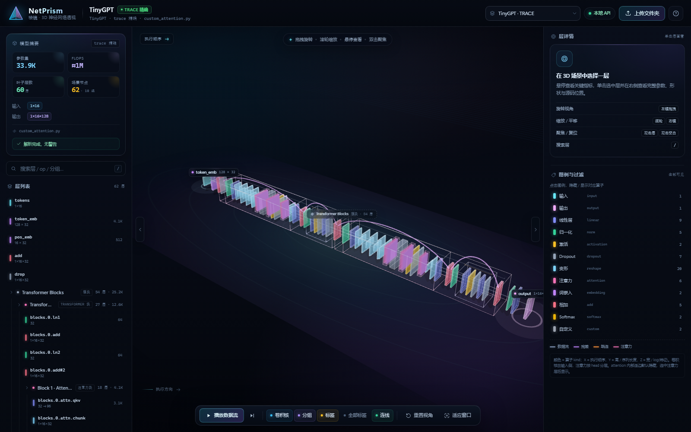 |

| U-Net（skip 拼接） | 悬停详情 |
|---|---|
| 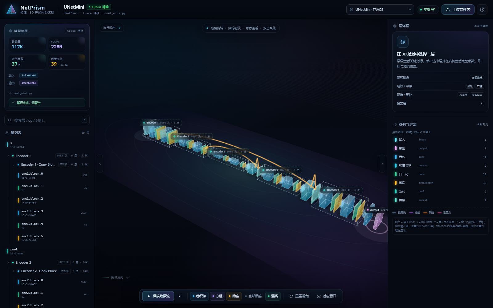 | 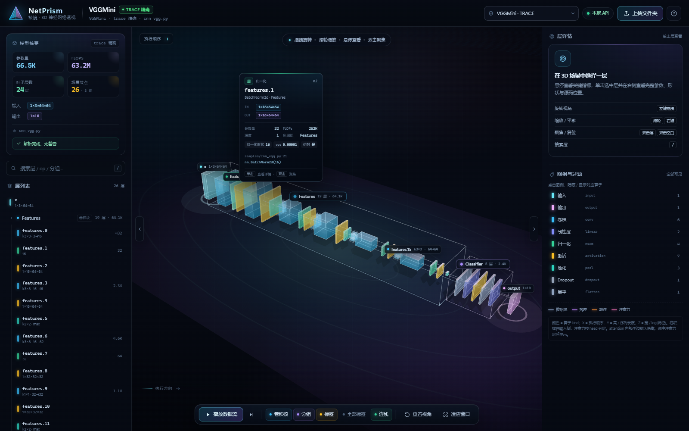 |

## 多格式与科研分析

| 格式 | 后缀 | 解析方式 | 依赖 |
|---|---|---|---|
| PyTorch 源码 | `.py` | FX trace / AST 回退 | torch（trace 可选） |
| ONNX | `.onnx` | shape inference + initializer | `onnx` |
| TorchScript | `.pt` / `.pth` | `torch.jit.load` + 执行记录 | torch |
| Keras v3 | `.keras` | zip 内 `config.json` | 无 |

指标：参数量、FLOPs / MACs、激活显存、感受野（估算，按输出 shape 与算子超参推导）。
Web 端按 `T` 打开层表格，可排序、搜索、导出 CSV；CLI 用 `report` / `compare` 生成 Markdown/CSV/HTML 或 JSON 对比。
多格式 demo：`python -m netprism serve examples/multiformat --open`（ONNX / TorchScript / Keras 各一个）。
详见 [多格式与分析](docs/FORMATS.md)。

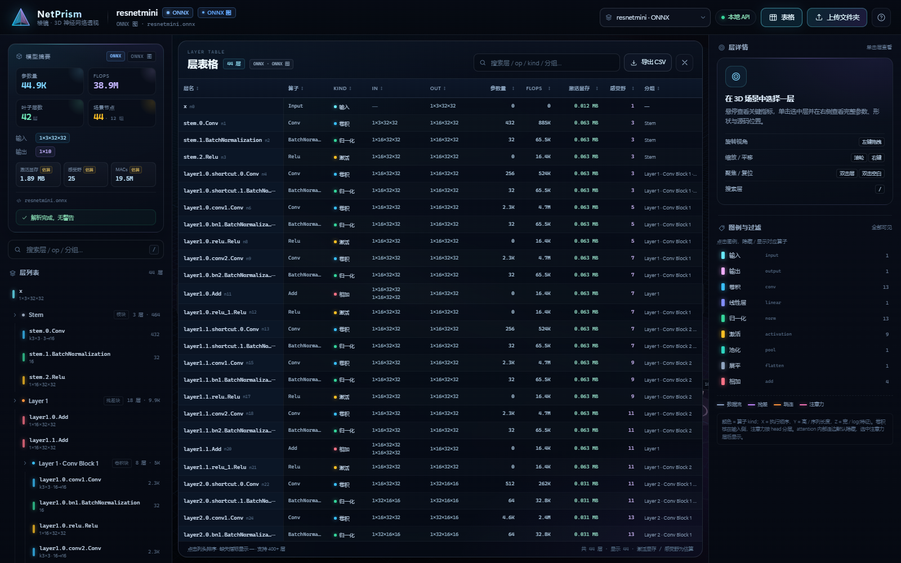

## 算法理解

- 知识库：**102 个架构家族 / 56 个组件**，覆盖 CNN、ResNet、DenseNet、MobileNet、ConvNeXt、ViT、Swin、Transformer、GPT、LLaMA、Mamba、RWKV、MoE、GNN、PointNet、UNet、DeepLab、NeRF、VAE、Diffusion 等；数据在 `netprism/data/algorithm_kb.json`，可扩展。
- 识别结果：家族 top-3 + 置信度 + 结构证据；组件模式（residual/bottleneck/depthwise/SE/CBAM/Inception/FPN/attention/FFN/RMSNorm/RoPE/SwiGLU…）+ 公式；forward 伪代码（带 shape）。
- CLI：`netprism explain <source>`；报告 md/html 含「算法理解」；Web 按 `A` 打开算法面板，层详情显示该层公式/语义/hover semantic。
- 分类是**结构启发式**：有置信度和证据；未知/非标准结构会返回 `unknown` + 原因，不硬编。

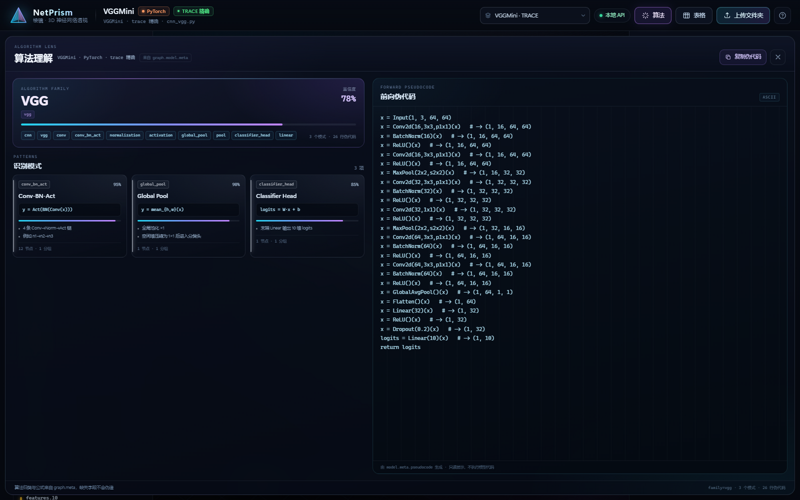

详见 [算法分类学](docs/ALGORITHM_TAXONOMY.md) · [算法契约](SPEC-ALGO.md)。

## 真实模型验证（2026-11）

不是只对手写样例有效。用 4 个真实开源仓库整目录回归：

| 仓库 | 解析结果（默认折叠变体） | 亮点 |
|---|---|---|
| [pytorch-cifar](https://github.com/kuangliu/pytorch-cifar) | 18 models / 17 trace / 0 errors | 工厂函数 `ResNet18()` 等被识别；ResNet、DenseNet、VGG、GoogLeNet 都 trace |
| [Pytorch-UNet](https://github.com/milesial/Pytorch-UNet) | 1 model / 1 trace | 包内相对导入 + 跨文件组件抑制；UNet 31.0M 参数、8 条 skip |
| [nanoGPT](https://github.com/karpathy/nanoGPT) | 1 model / 1 trace | 自动使用 `GPTConfig()` 默认值；GPT 124.5M 参数 |
| [vit-pytorch](https://github.com/lucidrains/vit-pytorch) | 37 models / 17 trace | ViT、CaiT、CrossFormer 等 trace；复杂模型 static + 明确 warning |

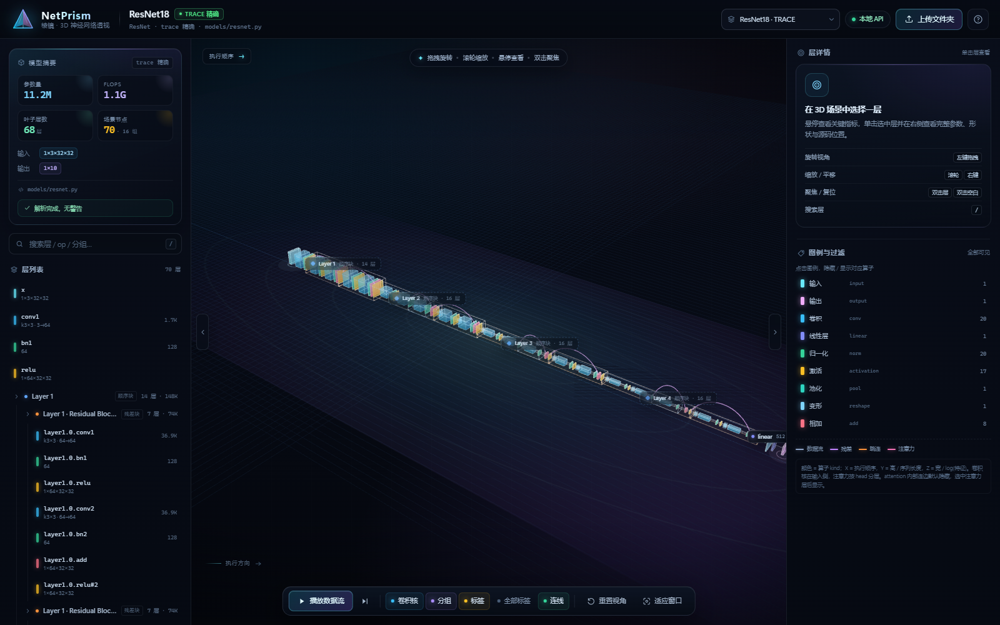
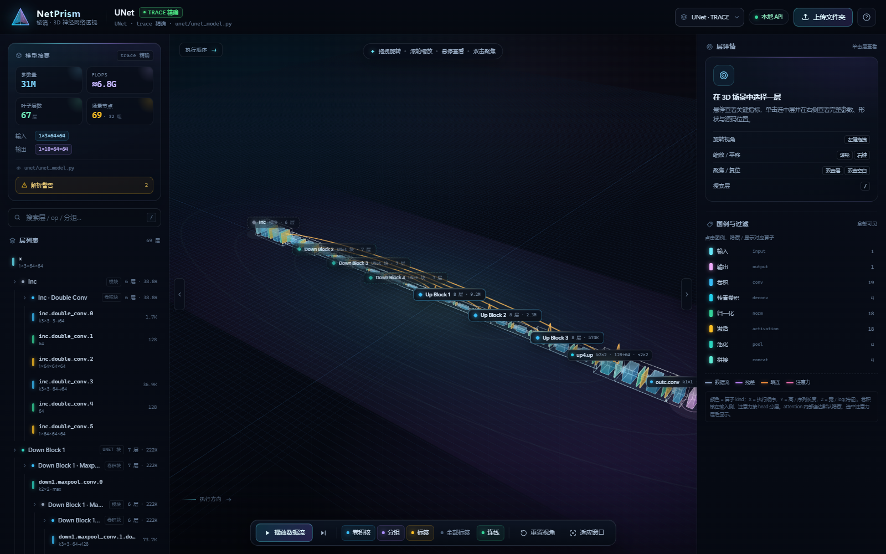

外部算法语料（17 个 GitHub 仓库 / 47 个模型，含 DETR、SAM、YOLOv5、Swin、Mamba、RWKV、KAN、PointNet++、NeRF、Diffusion、GCN）：
[`benchmarks/EXTERNAL.md`](benchmarks/EXTERNAL.md)。静态/ trace 测试：`pytest tests/test_external_corpus.py -q`。

复现与细节：[真实世界验证](docs/REAL_WORLD.md) · 回归脚本 [`scripts/eval_real.py`](scripts/eval_real.py)。

## 它能识别什么

| 家族 | 识别对象 |
|---|---|
| CNN | `Conv1d/2d/3d`、`ConvTranspose*`、`BatchNorm*`、`MaxPool*`、`AvgPool*`、`AdaptiveAvgPool*`、`Flatten`、`Dropout` |
| 残差网络 | 自定义 `BasicBlock` / `Bottleneck`、identity / 1×1 投影 shortcut、`x + identity` |
| Transformer | `nn.Embedding`、位置编码、`nn.MultiheadAttention`、手写 QKV attention、`nn.TransformerEncoderLayer/Encoder`、FFN、`LayerNorm`、残差 |
| U-Net / 多分支 | `torch.cat` skip、`ConvTranspose2d`、Encoder/Decoder 结构 |
| 序列模型 | `LSTM`、`GRU`、`RNN`、`Embedding`、`Linear` 分类头 |
| 小组件 | 任意自定义 `Attention`、`FFN`、`MLP`、`Block` 命名启发式 + 真实结构推断 |

## Web 操作

| 操作 | 效果 |
|---|---|
| 左键拖拽 | 旋转视角 |
| 滚轮 | 缩放 |
| 右键拖拽 | 平移 |
| 悬停层 / 卷积核 / 连线 | 显示详情 tooltip |
| 单击层 | 选中，右侧显示完整信息，高亮上下游 |
| 双击层 | 相机聚焦该层 |
| 双击空白 / `R` | 复位视角 |
| `/` | 聚焦搜索框 |
| `T` | 层表格 |
| `A` | 算法理解面板 |
| `Shift+A` | 全部标签 |
| `空格` | 播放 / 暂停数据流 |
| `→` / `←` | 单步前进 / 后退 |
| `G` / `K` / `L` | 切换分组框 / 卷积核 / 标签 |
| `Esc` | 取消选中 / 关闭面板 |

> 完整快捷键见 [`web/README.md`](web/README.md)。

## 解析结果长什么样

`scan` 会为每个模型输出一份 schema 版本化的 JSON（见 [`schema/graph.schema.json`](schema/graph.schema.json)），
包含 `nodes`（层、形状、参数、FLOPs、源码位置）、`edges`（数据流/残差/skip）与 `groups`（组件层级）。
示例：

```json
{
  "id": "n7",
  "name": "layer1.0.conv1",
  "op": "Conv2d",
  "kind": "conv",
  "inShapes": [[1, 16, 32, 32]],
  "outShapes": [[1, 16, 32, 32]],
  "params": {"inChannels": 16, "outChannels": 16, "kernelSize": [3, 3], "stride": [1, 1], "padding": [1, 1]},
  "numParams": 2304,
  "flops": 4718592,
  "source": {"line": 22, "code": "nn.Conv2d(in_channels, out_channels, kernel_size=3, padding=1)"}
}
```

适合二次开发：可以拿 JSON 做自定义分析、导出到论文/PPT，或接自己的前端。

## 项目结构

```
netprism/
├─ netprism/            # Python 包
│  ├─ core/             # PyTorch 解析：发现 / FX trace / 静态 AST / 分组 / 构图
│  ├─ adapters/         # ONNX / TorchScript / Keras v3 适配器
│  ├─ algorithms.py     # 算法模式/家族/公式/forward 伪代码
│  ├─ algorithm_kb.py   # 知识库加载器
│  ├─ data/             # algorithm_kb.json（102 families / 56 components）
│  ├─ metrics.py        # 参数量 / FLOPs / 激活显存 / 感受野
│  ├─ report.py         # Markdown / CSV / HTML 报告
│  ├─ compare.py        # 模型结构对比
│  ├─ schema.py         # 冻结的数据契约与校验
│  ├─ cli.py            # scan / inspect / report / compare / serve / view
│  └─ server.py         # 标准库 HTTP 服务 + 上传/扫描 API
├─ web/                 # 原生 ES modules + 本地 Three.js
├─ samples/             # 9 个覆盖 CNN/ResNet/Transformer/UNet/MLP 的样例
├─ tests/               # 契约、解析、样例、CLI/HTTP 测试
├─ examples/demo/       # 由 samples 生成的演示数据
├─ schema/              # JSON Schema
├─ packaging/           # Windows EXE 启动器与图标
├─ dist/                # 已构建的 EXE（单文件 + 目录版）
└─ docs/                # 架构、解析算法、研究背景
```

## 开发

```powershell
# 测试（通用：python 需 ≥3.10 且安装 pytest）
python -m pytest tests -q

# 本工作区的解释器不在 PATH 时：
# $py = "C:\Users\hrbkcy2523\.dsh\dsh-runtimes\dsh-primary-runtime\dependencies\python\python.exe"
# & $py -m pytest tests -q

# 重新生成 demo 数据（8 个模型，含 static/hook 回退样例）
python scripts/build_demo.py

# 只跑 Web（不依赖后端服务；静态 demo 兜底）
python -m http.server 8123 --directory web
```

`examples/demo/` 与 `web/demo/` 都包含 8 个模型的预解析结果，静态托管 `web/` 时可直接浏览；
用 `netprism serve examples/demo` 启动后还能切换模型、上传文件夹做静态解析。

设计文档：[架构](docs/ARCHITECTURE.md) · [解析算法](docs/PARSING.md) · [真实世界验证](docs/REAL_WORLD.md) · [多格式与分析](docs/FORMATS.md) · [相关工作调研](docs/RESEARCH.md)。

## 限制

- 目前以 **PyTorch** 为主；ONNX/TorchScript/Keras v3 已支持。Keras 只读 `config.json` 推导结构与参数，不加载权重/执行模型。
- `static` 模式只能推导它看得懂的写法；遇到复杂控制流/自定义 op 会给出 warning，形状可能不完整。未知调用一律保守处理为未知维度，不会伪装成 identity；多输入 forward 与常见 helper/FFT/einsum 已支持。
- `trace` 模式要求模型能无参（或全默认参数/可合成参数）实例化；需要 list/callable 等参数时会回退静态解析。
- TorchScript 的逐层形状来自执行记录，复杂控制流或自定义 op 可能只有部分形状；ONNX 的 BN/常量折叠会让节点数与训练代码不同。
- 多输入 / 多输出、动态 shape、共享模块的展示仍在完善；>250 层时 UI 会自动简化标签。
- 同一文件里的工厂变体默认只显示第一个；需要全部时用 `--all-variants`，需要特定变体用 `--class`。
- FLOPs、激活显存、感受野均为**估算**（1 MAC = 2 FLOPs），在 UI/报告中标明；不同论文口径可能不同。
- 算法家族识别是**结构启发式**（102 家族 KB + 组件签名 + 别名），会给出置信度/证据；非标准实现可能落到 `unknown`，不会硬套名字。

## 相关工作

NetPrism 借鉴了这些优秀工具的界面与交互思路，但定位不同：从**文件夹**开始，以**3D 张量体积**呈现，
并同时覆盖 CNN 卷积核与 Transformer 组件。

- [Netron](https://github.com/lutzroeder/netron) — 模型文件格式查看器（ONNX/TFLite 等），2D 图信息密度高。
- [torchview](https://github.com/mert-kurttutan/torchview) — PyTorch 计算图可视化，可导出 graphviz。
- [TorchVista](https://github.com/sachinhosmani/torchvista) — notebook 内交互式前向图。
- [visualkeras](https://github.com/paulgavrikov/visualkeras) — Keras 分层式结构图。
- [Transformer Explainer](https://poloclub.github.io/transformer-explainer/) — 交互式解释 Transformer 推理过程。

## License

MIT
