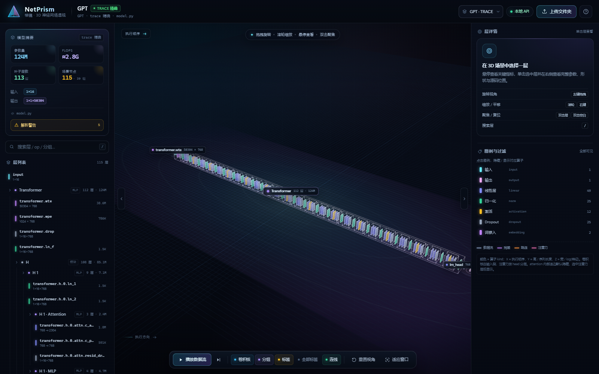

# 真实世界模型验证

> 目标不是“在 9 个手写样例上能跑”，而是**把别人仓库的整个 models 文件夹扔进来，也能得到可信的结构**。
> 本文记录 4 个真实开源仓库的回归结果、典型问题和解析器的应对方式。
> 数据采集：2026-11-24，Windows 11 / CPU，PyTorch 2.15.0+cpu，NetPrism `schema v1.0`。

## 1. 方法与命令

```powershell
# 克隆到临时目录（只用于评测，不进入项目）
git clone --depth 1 https://github.com/kuangliu/pytorch-cifar
git clone --depth 1 https://github.com/milesial/Pytorch-UNet
git clone --depth 1 https://github.com/karpathy/nanoGPT
git clone --depth 1 https://github.com/lucidrains/vit-pytorch

# 整目录解析（默认 trace，同类的工厂变体默认折叠）
python -m netprism scan .\pytorch-cifar --out .\out_cifar
python -m netprism view .\Pytorch-UNet --open

# 一次跑四个仓库的回归指标
python scripts/eval_real.py
```

**变体折叠**：真实仓库常在一个文件里暴露 `ResNet18/34/50/101/152`。默认只保留同类第一个变体，
让“一键查看”的列表保持可读；`--all-variants` 保留全部，`--class ResNet50` 可精确选择任意变体。
折叠只发生在 CLI/HTTP 展示层，`analyze_folder()` 公共 API 仍返回全部模型。

## 2. 总览

| 仓库 | 规模（文件/模型类） | 解析结果（默认折叠） | 关键收益 |
|---|---|---|---|
| [kuangliu/pytorch-cifar](https://github.com/kuangliu/pytorch-cifar) | 9 个模型文件，18 个架构家族 | **18 models / 17 trace / 1 static / 0 errors** | 工厂函数 `ResNet18()`、`DenseNet121()` 等被识别；ResNet18/34/50、DenseNet121、VGG、GoogLeNet、MobileNetV2 等 trace |
| [milesial/Pytorch-UNet](https://github.com/milesial/Pytorch-UNet) | `unet/` 包，4 个 Module 类 | **1 model / 1 trace / 0 static / 0 errors** | 包内 `from .unet_parts import *` 相对导入可用；跨文件组件 `Down/Up/OutConv` 不再误当模型；UNet trace **31.0M params、8 条 skip** |
| [karpathy/nanoGPT](https://github.com/karpathy/nanoGPT) | 单文件 GPT，需 `GPTConfig` | **1 model / 1 trace / 0 errors** | 从 dataclass 默认值合成 `GPTConfig()`；trace 出 **124.5M params / 113 节点** |
| [lucidrains/vit-pytorch](https://github.com/lucidrains/vit-pytorch) | 70+ 模型文件 | **37 models / 17 trace / 20 static / 0 errors** | ViT、SimpleViT、CaiT、CrossFormer、CvT、LeViT、NaViT 等 trace；无法安全合成参数/依赖的模型落到 static 并写明确 warning，不崩溃 |

> 原始扫描共 83 个模型（56 个 trace）；默认折叠变体后 UI 中呈现 57 个模型（36 个 trace），
> 其余 static 都有理由；没有文件级 error。相比第一版：
> pytorch-cifar 只有 6 个 trace、UNet 0 个 trace、nanoGPT 2 层骨架、vit-pytorch 94 个噪声模型。

## 3. 四个真实难点

### 3.1 工厂函数：`ResNet18()` 不是类

`pytorch-cifar/models/resnet.py` 里：

```python
class ResNet(nn.Module):
    def __init__(self, block, num_blocks, num_classes=10):
        ...
def ResNet18():
    return ResNet(BasicBlock, [2, 2, 2, 2])
```

第一版把 `BasicBlock`、`Bottleneck`、`ResNet` 都当模型，全部 static 骨架；现在：

- 模块级无参工厂被识别并实际调用，图名为 `ResNet18`，`className` 为 `ResNet`；
- 工厂返回/消费的 `BasicBlock` 不再作为顶层模型；
- 同文件多个工厂保留，但 CLI/UI 默认折叠为每个架构家族一个代表，`--all-variants` 可展开。


### 3.2 包内相对导入：`from .unet_parts import *`

`Pytorch-UNet/unet/unet_model.py` 依赖同包文件；第一版按单文件 `import` 失败，UNet 只能 static。
现在导入器会向上寻找包根，把包父目录加入 `sys.path`，用 dotted name 导入，因此：

- UNet **trace**：67 层 / 69 节点、**31,038,218** 参数、8 条 skip；
- 跨文件组件抑制：`Down/Up/OutConv` 定义在 `unet_parts.py`、在 `unet_model.py` 里作为子模块实例化，
  扫描整个文件夹时不再被当成顶层模型（单文件 `analyze_file` 行为不变）；
- 最终整个仓库只显示 **1 个 UNet**，符合用户心智。


### 3.3 配置 dataclass：nanoGPT 的 `GPTConfig`

`nanoGPT/model.py` 的 `GPT.__init__(self, config)` 需要配置对象。解析器会：

- 发现同文件/同包的 dataclass，使用默认值实例化（`GPTConfig()`）；
- 常见必填参数按名字启发（`n_channels=3`、`n_classes=10`、`image_size=32/224`、`vocab_size=128` 等），
  并写入 warning；
- 构造参数是 list/callable 等无法自信合成的情况，直接回退 static，不瞎猜。



### 3.4 大模型与噪声：vit-pytorch

这个库有 70+ 模型文件、大量变体与 wrapper。第一版扫出 94 个“模型”且全部 static。
现在：

- 引用图覆盖所有方法/类参数/工厂体，跨文件组件被抑制（`AutoencodingHead`、`MPP` 等）；
- 同名校准去重（`vit.py` 的 ViT 优先）；
- 45 个原始模型降到 **37 个可读模型**，ViT/SimpleViT/CaiT/CrossFormer/CvT 等 trace；
- CCT 大模型 forward 超过 4 秒预算、或依赖 `einops` Proxy 无法 FX 的情况下写清楚 warning 后走 static。

## 4. 性能观察

| 模型 | UI 节点数（含输入/输出） | 产出 / 加载 |
|---|---|---|
| ResNet18 | 70 | scan <1s；UI 首屏 ~2.8s |
| UNet (真实) | 69 | scan ~1.3s；UI ~5.2s |
| GoogLeNet | 217 | UI ~2.7s；自动进入“大模型模式” |
| DenseNet121 | 426 | UI ~5.6s；标签自动收敛，仅保留组标签 |
| nanoGPT GPT | 115 | UI ~5.4s；5 条解析 warning 在右栏可见 |
| vit-pytorch 整目录 | 37 models | scan ~83s（逐个尝试 trace），0 errors；单模型查看 <6s |

解析时间主要花在真实 forward 上；UI 对 >250 节点会自动隐藏部分标签、降低几何复杂度。
如果只想快速看结构，用 `--static` 可以把 4 个仓库的扫描时间降到秒级（形状为推导值）。

## 5. 仍然存在的限制

- 复杂动态控制流、`einops` 等不可 FX 的算子：能 hook 回退的会回退，否则 static；
- 必填参数是 list/callable/未知类型时不猜测，宁可在 UI 上标明 static；
- 超大模型（>500 节点）的 3D 场景仍是一条很长的“管道”，更适合用搜索/层列表/大模型模式，
  未来可做重复 block 的折叠布局；
- 真实仓库的 `train.py`、`utils/` 等非模型文件不产生模型（也不会污染列表）。

## 6. 复现

```powershell
python scripts/eval_real.py --root %TEMP%\netprism_eval
python scripts/eval_real.py --repos pytorch-cifar Pytorch-UNet --json report.json
```

脚本只读仓库，输出 models/trace/static/errors、interesting-model 是否命中、耗时与 schema 校验结果，
可直接用于后续版本回归。
